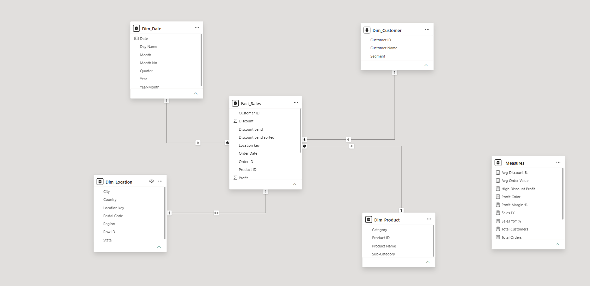
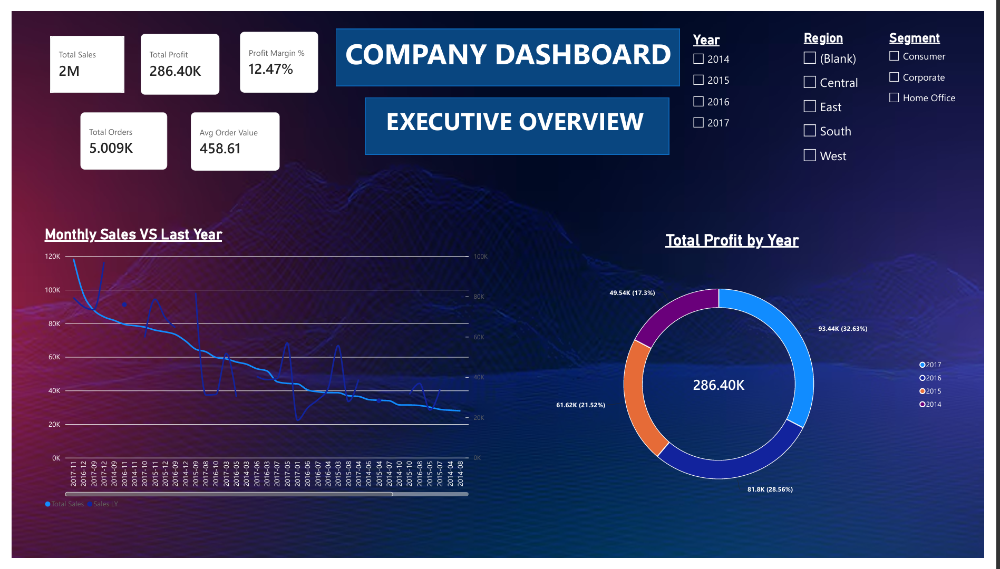
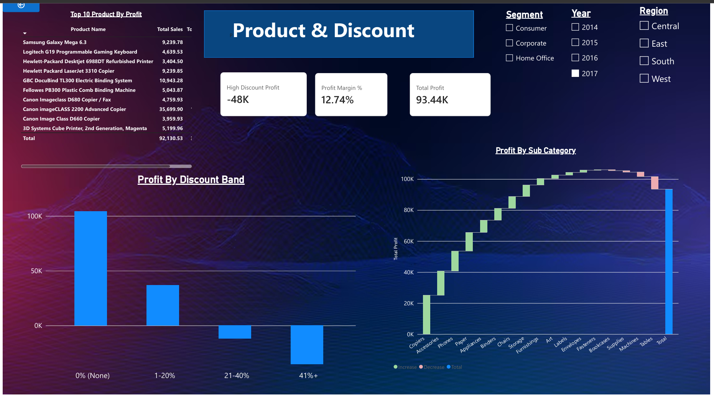
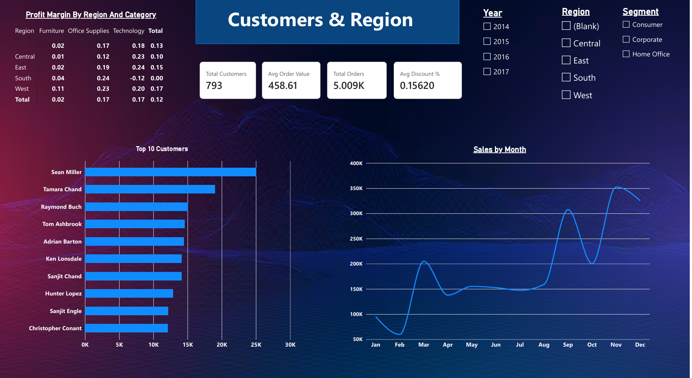

# Superstore Sales & Profit Dashboard (Power BI)

## Objective
Analyze retail sales and profit to find where discounts, products,
and regions lose money, and recommend improvements.

## Dataset
Sample Superstore: 9,994 order lines, Jan 2014 - Dec 2017,
4 regions, 3 categories.

## Tools
Power BI Desktop, Power Query, DAX

## Data preparation
- Set date columns using the US locale
- Restored lost leading zeros on postal codes
- Removed duplicate product IDs
- Added Days to Ship and Discount Band columns

## Data model
Star schema: Fact_Sales with Dim_Customer, Dim_Product, Dim_Location, Dim_Date.

## DAX measures (12)
- Total Sales, Total Profit, Total Quantity (SUM)
- Profit Margin %, Avg Order Value (DIVIDE)
- Total Orders, Total Customers (DISTINCTCOUNT)
- Avg Discount % (AVERAGE)
- Sales LY, Sales YoY % (CALCULATE, SAMEPERIODLASTYEAR)
- High Discount Profit (CALCULATE with a filter)
- Profit Color (IF)

## Dashboard

## Key insights
1. Discounts above 20% lost about $135K, and the loss grew each year.
2. Furniture earns only a 2.5% margin; Tables and Bookcases lose money.
3. Central region margin is 7.9% vs about 14.9% in the West.

## Recommendations
Cap discounts at 20%, reprice Tables and Bookcases, and audit Central,
Texas, Ohio, and Pennsylvania.

## How to open
Download `Superstore_Dashboard.pbix` and open it in Power BI Desktop (Windows).
